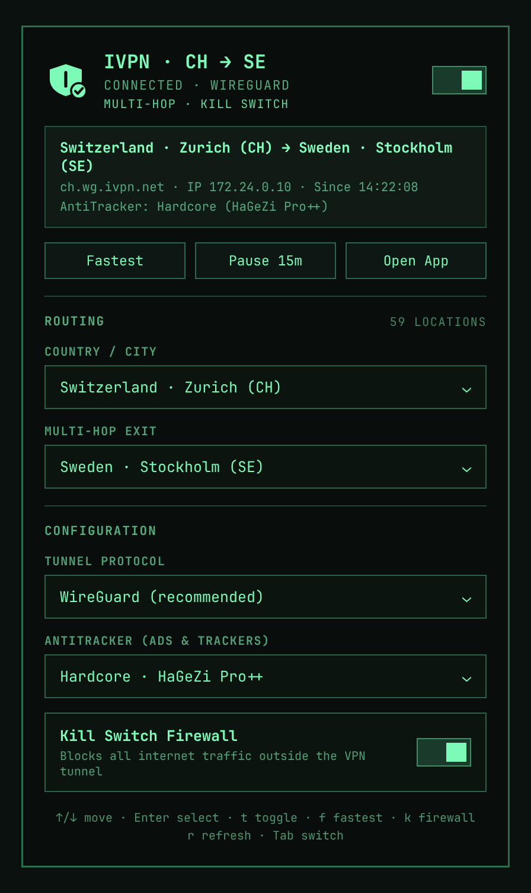

# Omarchy IVPN Bar Widget

A native, keyboard-driven [Omarchy](https://omarchy.org/) QuickShell bar widget for controlling [IVPN](https://www.ivpn.net/) directly from your top bar.



## Features

- **Theme-native vector shield icon** with status badges (`✓` connected, `—` disconnected, `‖` paused, pulsing when connecting, `!` urgent) and optional 2-letter country code (`CH`, `US`, `SE`, …) right in the bar.
- **Searchable Country / City picker** across all IVPN locations (search by country, city, country code, hostname, or ISP), plus **Fastest** and **Random** server options.
- **Multi-Hop Exit selector** with searchable countries/cities that automatically excludes the entry server's country.
- **Live connection telemetry** showing active route (`Entry → Exit` in Multi-Hop), hostname, VPN IP, connect time, DNS, and AntiTracker status.
- **One-click controls:** Connect/disconnect switch, **Fastest**, **Pause 15m / Resume**, **Tunnel Protocol** (WireGuard / OpenVPN), **AntiTracker** (Off, Standard, Hardcore blocklists), **Kill Switch Firewall**, and **Allow LAN Traffic**.
- **Built-in onboarding & recovery:** Inline Account ID login when logged out, and Polkit-confirmed service startup if `ivpn-service` is stopped.
- **Mouse, keyboard & IPC support:**
  - **Bar icon:** Left-click opens panel · Right-click toggles VPN · Middle-click refreshes
  - **Keyboard:** `↑`/`↓` move · `Enter` select · `t` toggle VPN · `f` fastest · `k` toggle Kill Switch · `r` refresh · `Tab` switch panel · `Esc` close

## Requirements

Install the official IVPN Arch package from the AUR:

```bash
yay -S ivpn
```

Optional: install `ivpn-ui` if you also want the full IVPN desktop app (`Open App` button appears automatically when installed):

```bash
yay -S ivpn-ui
```

## Installation

Install and enable with Omarchy's plugin CLI:

```bash
omarchy-plugin-add https://github.com/gpt4omni/omarchy-ivpn --enable --yes
```

Or clone manually into your Omarchy plugins directory:

```bash
git clone https://github.com/gpt4omni/omarchy-ivpn ~/.config/omarchy/plugins/io.github.gpt4omni.ivpn
omarchy-plugin-enable io.github.gpt4omni.ivpn
```

## Removal

```bash
omarchy-plugin-remove io.github.gpt4omni.ivpn
```

Removing the plugin does not touch your IVPN installation, account, or firewall settings.

## IPC Commands

```bash
qs ipc -p /usr/share/omarchy/shell call io.github.gpt4omni.ivpn toggle
qs ipc -p /usr/share/omarchy/shell call io.github.gpt4omni.ivpn toggleVpn
qs ipc -p /usr/share/omarchy/shell call io.github.gpt4omni.ivpn connectFastest
qs ipc -p /usr/share/omarchy/shell call io.github.gpt4omni.ivpn toggleFirewall
qs ipc -p /usr/share/omarchy/shell call io.github.gpt4omni.ivpn status
```

## Development & Tests

```bash
node --test test/model.test.js
omarchy-plugin-validate .
```

## Disclaimer

This is an independent, unofficial community plugin for the locally installed IVPN CLI. It invokes `ivpn` with fixed argument arrays and never modifies IVPN state files directly.

## License

MIT — see [LICENSE](LICENSE).
